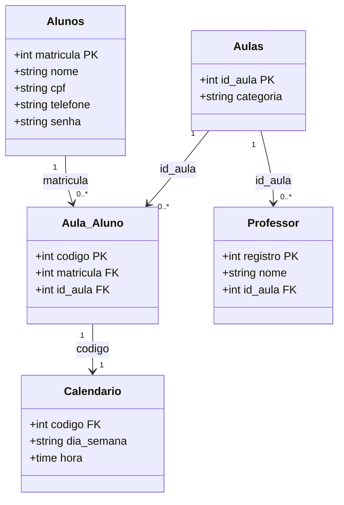

  <h1 align="center" style="color:red;">
    🏋️‍♂️ Academia 🏋️‍♀️
</h1>

  

## Projeto desenvolvido para conclusão do Santander Dev Week com parceria DIO.me 
Este sistema foi construído em Java, utilizando Spring Boot, Maven como gerenciador de dependências e H2 Database durante o desenvolvimento.

Trata-se de uma API Restful que permite aos alunos de uma academia consultar:

> Em quais categorias estão matriculados

> Os dias e horários das aulas

> O professor responsável por cada categoria

O objetivo é demonstrar domínio em backend Java, modelagem de dados, boas práticas de API e documentação.

## 🚀 Tecnologias utilizadas

## Diagrama de classes:

